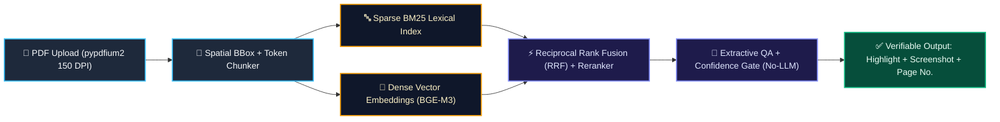
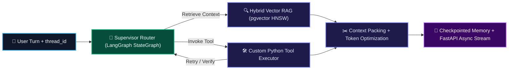

<div align="center">

<!-- XML-Validated 3D Animated Waving Header Banner -->


<!-- Verified Animated Typing SVG -->
<a href="https://github.com/KundanKt">
  
</a>

<p align="center">
  <em>Final-Year B.Tech ECE Undergraduate @ Chaibasa Engineering College (JUT) — Architecting production-grade AI systems from official documentation and research papers.</em>
</p>

<!-- Contact & Profile Badges -->
<p align="center">
  <a href="https://www.linkedin.com/in/ktkumar72/">
    
  </a>
  <a href="https://github.com/KundanKt">
    
  </a>
  <a href="mailto:kundank204@gmail.com">
    
  </a>
</p>

</div>

---

## ⚡ Engineering DNA — Why I Build Without Courses

```yaml
Name               : Kundan Kumar Thakur
Role               : AI Software Engineer (Fresher) | Systems & Agentic Architect
Education          : B.Tech in ECE (4th Year) — Chaibasa Engineering College (JUT)
Learning Approach  : 100% Official Documentation, Specs & Research Papers (Zero Courses)
Core Focus         : Hybrid Search (BM25 + Vectors), Stateful LangGraph Agents, RAG & Model Optimization
Contact            : kundank204@gmail.com | +91-7321897266 / +91-8863971299
```

---

## 🛠️ 3D Technical Arsenal

<div align="center">

### Core Languages, Frameworks & Infrastructure
<p align="center">
  
</p>

### AI, Agentic Orchestration, Retrieval & Optimization Stack
<p align="center">
  
  
  
  
  <br/>
  
  
  
  
</p>

</div>

---

## 🏗️ System Architectures (Visual Blueprints)

### 1️⃣ Zero-LLM PDF Hybrid Search & Visual Proof Engine
> **80%–90% Retrieval Precision · 0% Generative Hallucination · Verifiable Page Screenshot & Highlight Proof**



### 2️⃣ Stateful Multi-Agent & Production RAG Architecture (`LangGraph`)
> **Cyclic StateGraph · Conditional Routing · Custom Tool Loops · Checkpointed Memory**



---

## 🧩 Featured Production Systems

<table width="100%">
  <tr>
    <td width="50%" valign="top">
      <h3 align="center">🔍 1. No-LLM PDF Hybrid Search Engine</h3>
      <p align="center">
        
        
        
      </p>
      <p>
        An ultra-fast, <b>zero-LLM document intelligence engine</b> designed to fetch <b>80%–90% relevant content</b> from uploaded PDFs with verifiable visual proof and zero hallucination.
      </p>
      <ul>
        <li><b>Hybrid Retrieval:</b> Combines sparse <code>BM25</code> keyword search with dense vector retrieval (<code>BGE-M3</code> / <code>Qdrant</code>) via Reciprocal Rank Fusion (RRF).</li>
        <li><b>Extractive QA Gate:</b> Isolates exact verbatim spans with a non-generative confidence threshold.</li>
        <li><b>3-Fold Proof:</b> Returns <b>highlighted matching text</b>, <b>rendered 150 DPI page screenshot excerpts</b> with yellow bounding boxes, and <b>complete A-to-Z page numbers</b>.</li>
      </ul>
    </td>
    <td width="50%" valign="top">
      <h3 align="center">🕸️ 2. Stateful Multi-Agent System</h3>
      <p align="center">
        
        
        
      </p>
      <p>
        A branching, stateful multi-agent conversational architecture built with <b>LangGraph</b> and <b>LangChain</b> for complex multi-step reasoning.
      </p>
      <ul>
        <li><b>Typed StateGraph:</b> Shared state schema tracking conversation history, retrieved documents, and tool outputs.</li>
        <li><b>Conditional Edge Routing:</b> Supervisor node dynamically routes execution between specialized sub-agents and custom Python tools with self-correction loops.</li>
        <li><b>Persistent Memory:</b> Thread-level checkpointing maintains context across long multi-turn sessions.</li>
      </ul>
    </td>
  </tr>
  <tr>
    <td width="50%" valign="top">
      <h3 align="center">🏗️ 3. SiteVaani — Construction AI Assistant</h3>
      <p align="center">
        
        
      </p>
      <p>
        A domain-specific AI assistant for the construction industry that resolves on-site civil and material estimation queries over WhatsApp using FastAPI webhooks and domain-grounded RAG retrieval.
      </p>
    </td>
    <td width="50%" valign="top">
      <h3 align="center">⚙️ 4. Model & Token Optimization Lab</h3>
      <p align="center">
        
        
      </p>
      <p>
        Hands-on engineering of Transformer self-attention mechanics, semantic token windowing, context compression, prompt caching, and <code>FP16</code>/<code>INT8</code>/<code>4-bit QLoRA</code> optimization built directly from official specs.
      </p>
    </td>
  </tr>
</table>

---

## 📊 3D GitHub Telemetry & Analytics

<div align="center">
  
</div>

<div align="center">
  
  
  
</div>

<!-- XML-Validated 3D Animated Waving Footer -->

